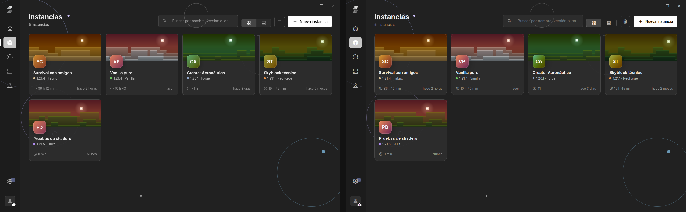
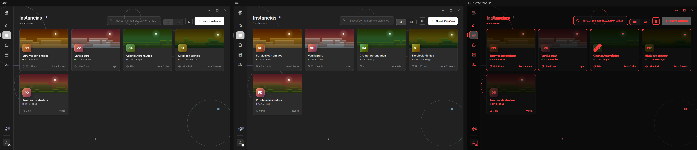

# Entrega: spike de Shard en GPUI (fase 0)

Rama `spike/gpui` (desde `main`, 503d9bc). Código en `ui-gpui/`, datos y
capturas en `docs/spike-gpui/`. Fecha: 2026-11-23.

## Veredicto

**Seguir con GPUI (go condicionado).** Con el criterio del PLAN se cumple aquí:
RAM GPUI = **46–54 % de Flutter** (≤ 60 %) en las 6 mediciones de memoria y la
bandeja funciona (abrir, ocultar, salir). Condición: Hermes debe repetir
`medir.sh` en el PC de Sebas (niri, RTX 4070) y en Windows, porque aquí las
dos apps pintan **por software** (sin acceso a la GPU Intel) y la bandeja se
probó por D-Bus, sin panel visible. Si allí la RAM pasa del 60 % o la bandeja
no se ve en niri/Windows, me quedaría en Flutter.

## Qué se construyó

- Crate `ui-gpui` (binario `shard-gpui`) sobre `gpui-kit =0.11.0`
  (→ `gpui-pre =0.3.14`) y `gpui-tray =0.3.0` (feature `gpui-kit`, mismo GPUI).
  Workspace propio: no toca el `Cargo.lock` de `core/` ni de `app/rust`.
- Lee las instancias con `lcore::Core` directo, sin bridge.
- Pantalla **Instancias** (rejilla, la del golden `instances_grid_es`): raíl,
  barra de título propia (min/max/cerrar, arrastre, doble clic maximiza),
  cabecera, buscador (`Input` de gpui-component, filtra de verdad), selector
  rejilla/lista (solo visual: la vista lista no está), papelera, «Nueva
  instancia», tarjetas con hover y fondo «Grafito» animado.
- Arte de las tarjetas portado 1:1 de `art.dart`: mismo hash FNV, el `Random`
  de la VM de Dart (MWC) y HCT con `material-colors`; con tests contra valores
  sacados de Dart. Iconos: subset de Material Symbols Rounded (8 KB).
- Ventana 1280×800, mínimo 960×600, decoraciones del cliente.
- Bandeja: «Abrir Shard», «Ocultar», «Salir»; clic en el icono abre. Cerrar la
  ventana la manda a la bandeja (como `close_behavior = tray`).
- Datos de prueba: `shard-gpui --seed DIR` escribe con `lcore` las 5
  instancias de `fake_bridge.dart`. Flutter lee la misma carpeta con su core
  real (`SHARD_DATA_DIR`), así las dos apps cargan exactamente lo mismo.
- Parches de spike en Flutter (solo medición): `SHARD_START_ROUTE` en
  `main.dart` y marcador de primer fotograma con `SHARD_SPIKE_TIMING=1` en
  `instances_page.dart`.

## Mediciones (Bash, mediana de 3)

Equipo: i5-12450H, 15 GB, Intel UHD (Alder Lake). Sin escritorio: weston 14
headless + Xwayland *rootful* (`:7`). Las dos apps por X11. **Render por
software en las dos**: Flutter con Mesa llvmpipe (GL, Impeller) y GPUI con
lavapipe (Vulkan); el usuario no está en el grupo `render` y no hay sudo.
Flutter 3.47.9 release; GPUI release (LTO thin, strip). Datos crudos:
`docs/spike-gpui/medicion-bash/`.

| métrica | Flutter | GPUI | GPUI/Flutter |
|---|---|---|---|
| Arranque hasta 1er frame con instancias | 631 ms | 243 ms | 39 % |
| RSS a 10 s (fondo animado) | 354.5 MB | 177.5 MB | 50 % |
| PSS a 10 s (fondo animado) | 307.0 MB | 141.6 MB | **46 %** |
| RSS tras 30 s de uso | 358.4 MB | 194.9 MB | 54 % |
| PSS tras 30 s de uso | 312.5 MB | 159.0 MB | **51 %** |
| CPU en reposo, fondo animado | 212.7 % | 108.8 % | 51 % |
| CPU en reposo, fondo quieto | 0.2 % | 0.3 % | — |
| RSS / PSS a 10 s, fondo quieto | 353.9 / 308.0 MB | 169.0 / 133.0 MB | 48 % / 43 % |
| RSS / PSS tras uso, fondo quieto | 354.0 / 308.0 MB | 187.2 / 151.1 MB | 53 % / 49 % |
| Bandeja: menú + «Salir» termina | sí (6/6) | sí (6/6) | |
| Tamaño tal cual | 65.7 MB (bundle) | 46.3 MB (1 binario) | 70 % |
| Tamaño con strip de los `.so` | 55.3 MB | 46.3 MB | 84 % |
| Tamaño tar.zst -19 | 16.5 MB | 13.6 MB | 82 % |

- Uso de 30 s (xdotool): hover por las 5 tarjetas, rueda, escribir «sur» en el
  buscador y borrar, cerrar a la bandeja y reabrir desde su menú, en bucle.
- «Fondo animado» es el valor por defecto de Flutter (Grafito, vaivén de 18 s
  a 60 fps); «quieto» = `performance: true` en `ui.json`.
- La CPU con fondo animado es casi toda el rasterizado por software; con GPU
  real será mucho menor en las dos. No sirve para comparar fluidez.
- La RAM con GPU real cambiará (los drivers por software reservan sus propios
  buffers). Por eso el veredicto es condicionado.
- Arranque: proceso nuevo con la caché de disco caliente (sin root no se puede
  vaciar la caché de páginas).

## Paridad visual

Capturas con fondo quieto (t = 0, como el golden), ratón fuera
(`tools/capturas.sh`, `tools/paridad.py`). Umbral del PLAN para la fase 0:
SSIM ≥ 0.9.

| par | SSIM | píxeles con ΔE > 10 |
|---|---|---|
| GPUI vs Flutter release (mismos datos) | **0.9749** | 1.74 % |
| GPUI vs golden `instances_grid_es` | **0.9473** | 2.56 % |
| Flutter release vs su golden (referencia) | 0.9620 | 1.39 % |



Flutter | GPUI | diferencias (rojo = ΔE > 10):


Diferencias señaladas:
- **Texto**: casi todo el rojo son bordes de glifos (Skia frente a
  cosmic-text/swash). Mismas fuentes Inter, mismos tamaños y alturas de línea.
- **Icono «CA»** (Create: Aeronáutica): su degradado diagonal es el que más
  difiere. Sospecho de la convención de ángulo de `linear_gradient` (135°)
  frente al `topLeft → bottomRight` de Flutter. No lo verifiqué.
- **Cabecera**: los controles quedan unos 4–8 px a la izquierda de los de
  Flutter (el botón «Nueva instancia» es algo más ancho).
- **Contra el golden** además: el golden usa la cuenta «NadiaK» (cara de skin
  en el raíl), la píldora «Create: Aeronáutica · En juego» y la etiqueta
  «En juego» en la tarjeta. Los datos sembrados no tienen cuenta ni partida en
  marcha, así que ninguna de las dos apps los pinta.
- Sombra del icono y halo del sol: muy parecidos. GPUI no tiene degradado
  radial; el paisaje se rasteriza en CPU a una imagen (5 imágenes de 273×104).

## Bandeja

- Probada en Bash **sin panel**: no hay host SNI. Las dos apps registran
  `org.kde.StatusNotifierItem-PID-1` con DBusMenu y se manejan por D-Bus
  (`tools/tray.sh`), como lo haría waybar o KDE.
- GPUI: «Ocultar» → 0 ventanas; «Abrir Shard» o clic en el icono → 1 ventana;
  «Salir» → el proceso termina con código 0. Medido en las 6 corridas.
- Flutter: mismo menú (más «Jugar…»), pero **al salir desde la bandeja muere
  con SIGSEGV (exit 139), 2 de 2 veces** en este entorno. Es un fallo de la app
  actual (tray_manager/nativeapi), no del spike. Conviene mirarlo aparte.
- Falta probar en niri (waybar), X11 con panel y Windows. Lo hace `medir.sh`
  en el PC de Sebas (columna `bandeja`) y se verifica a ojo que el icono se
  vea.

## Problemas encontrados

1. **Flutter 3.50 y la beta 3.51 no compilan la app**: `tray_manager 0.8` →
   `nativeapi 0.5.2` llama a `Isolate.create`, que en Dart 3.14 pasó a
   `dart:_vm`. Con Flutter **3.47.9** compila sin tocar el `pubspec.lock`.
   Hay que fijar la versión de Flutter en el repo.
2. **Iconos en GPUI**: cosmic-text descarta como fuente principal una cara sin
   glifo «m» (`gpui-pre-wgpu/src/cosmic_text_system.rs`). Además Inter tiene
   glifos propios en los mismos códigos PUA (U+E145 «+», U+E15B «−»). Con eso
   salían «7» y «™» en vez de iconos. Arreglo: el subset de iconos incluye «m»
   y tiene nombres únicos (`tools/subset_icons.py`).
3. **Bug del spike, ya arreglado**: el botón cerrar de GPUI no cerraba la
   ventana. `handle.update()` sobre la ventana que está despachando su propio
   clic falla, y `.ok()` se tragaba el error. Cada «cerrar + Abrir» dejaba una
   ventana más: 6 ciclos = 6 ventanas y 409 MB. Ahora la ventana se cierra con
   su propio `Window` y el error de `hide_window` se registra. Antes y después,
   con el mismo bucle de 6 ciclos: 6 ventanas / 409 MB → 0 ventanas tras cada
   cierre / 194 MB estable.
4. **gpui-tray renumera los ids del menú** en cada reconstrucción. Los paneles
   reales releen el layout y no les afecta, pero un script tiene que buscar por
   etiqueta (`tools/tray.sh` lo hace).
5. **Ocultar no libera mucho en GPUI**: cerrar la ventana baja la RSS solo
   unos 11 MB (el dispositivo gráfico sigue vivo). Hay margen si importa la
   RAM en segundo plano.
6. **GPUI hace panic si el compositor Wayland no tiene `wl_seat`** (weston
   headless). niri sí lo tiene, pero aquí no se pudo medir GPUI en Wayland
   nativo. Flutter en Wayland nativo midió casi lo mismo que en X11 (PSS
   312 MB, `medir.sh --wayland`, 1 corrida).
7. Xwayland *rootless* de weston headless hacía segfault con hide/show de
   ventanas. Se usó Xwayland *rootful*.
8. `vulkaninfo` no está instalado; el adaptador se dedujo de las librerías
   cargadas (`libvulkan_lvp.so` en GPUI, `libgallium` en Flutter).

## Para Hermes: medir en el PC de Sebas y en Windows

Linux (Arch, niri, RTX 4070):

```sh
git fetch && git checkout spike/gpui
cd ui-gpui && cargo build --release && cd ..
# Flutter 3.47.x estable (no 3.50+):
cd app && flutter build linux --release && cd ..
# Por X11 (xwayland-satellite de niri) con fase de uso automática.
# Necesita xdotool, imagemagick, zstd y python3:
ui-gpui/tools/medir.sh --runs 3 --out medicion-niri-x11
# Wayland nativo (sin fase de uso):
ui-gpui/tools/medir.sh --runs 3 --wayland --out medicion-niri-wayland
```

Mirar también a ojo que el icono de la bandeja salga en waybar y que su menú
abra, oculte y cierre las dos apps.

Windows (PowerShell 7, compilando las dos apps allí con MSVC y Flutter 3.47):

```powershell
cd ui-gpui; cargo build --release; cd ..\app; flutter build windows --release; cd ..
pwsh ui-gpui\tools\medir.ps1 -Flutter app\build\windows\x64\runner\Release -Gpui ui-gpui\target\release\shard-gpui.exe
```

Ese script mide arranque, Working Set, Private Bytes y CPU. La bandeja se
prueba a mano. No se pudo probar aquí: no hay Windows, y un Flutter de
Windows no se puede compilar desde Linux. Puede que el stdout de Flutter en
Windows no llegue a la tubería y falte el dato de arranque.

## Horas reales

≈ 0,9 h de reloj según `date` en Bash (20:22 → 21:14, -05). Se fue sobre todo
en preparar Flutter sin sudo (sysroot de GTK con 96 .deb, tres versiones de
Flutter), las compilaciones release y la medición (3 × 2 × 2 corridas,
unos 15 min).

## Archivos

- `ui-gpui/src/{main,view,art,data}.rs`: app, pantalla, arte portado y datos.
- `ui-gpui/tools/`: `medir.sh`, `medir.ps1`, `tray.sh`, `capturas.sh`,
  `paridad.py`, `subset_icons.py`.
- `docs/spike-gpui/`: CSV y resúmenes de la medición, capturas, mapas de
  diferencias y golden.
- `cargo test` en `ui-gpui/`: 6 tests (hash y `Random` iguales a Dart, textos
  del golden, siembra y lectura con `lcore`, lectura de `ui.json`).

## Medición en el PC de Sebas (2026-11-23)

Equipo: Ryzen 7 5800XT, 31 GB, **RTX 4070 (driver nvidia 620.73)**, Arch
(CachyOS 7.3), niri Wayland. Las dos apps por X11 (xwayland-satellite `:1`),
`medir.sh --runs 3`, mismos binarios release que en Bash. **GPU real en las
dos**: Flutter carga `libEGL_nvidia`/`libGLX_nvidia`; GPUI abre `/dev/nvidia0`
y carga `libnvidia-glvkspirv`/`rtcore` (Vulkan nvidia); las dos aparecen en
`nvidia-smi`. Datos: `docs/spike-gpui/medicion-pc/medicion-niri-x11/`.

| métrica (mediana de 3) | Flutter | GPUI | GPUI/Flutter |
|---|---|---|---|
| Arranque hasta 1er frame | 420 ms | 275 ms | 65 % |
| RSS / PSS a 10 s, animado | 347.7 / 173.1 MB | 272.4 / 117.1 MB | 78 % / **68 %** |
| RSS / PSS tras 30 s de uso, animado | 351.2 / 177.4 MB | 292.3 / 138.3 MB | 83 % / **78 %** |
| CPU reposo, fondo animado | 47.0 % | 15.2 % | 32 % |
| CPU reposo, fondo quieto | 0.0 % | 0.1 % | — |
| RSS / PSS a 10 s, quieto | 343.5 / 173.7 MB | 270.0 / 118.0 MB | 79 % / 68 % |
| RSS / PSS tras uso, quieto | 344.5 / 174.6 MB | 308.5 / 156.5 MB | 90 % / 90 % |

- Con GPU real la ventaja de RAM se achica: en Bash (render por software)
  GPUI estaba en 46-51 % del PSS; aquí 68-90 %. El driver nvidia mapea
  ~150 MB compartidos en las dos (RSS alto, PSS más bajo).
- Bandeja: niri no tiene bandeja propia; Sebas usa **Noctalia** (no waybar),
  que es host SNI. El item de GPUI quedó registrado en
  `StatusNotifierWatcher` y el icono sale en el panel. «Salir» desde el menú
  terminó el proceso en 4/6 corridas de GPUI y 3/6 de Flutter (los «no» son
  todos del modo animado, tras la fase de uso).
- La fase de uso automatizada no sirvió del todo aquí: el clic en el botón
  cerrar (coordenada fija 1253,22) no ocultó la ventana en ninguna app
  (72 avisos), así que el «cerrar a la bandeja» no se ejercitó.
- **Veredicto según el criterio (PSS GPUI ≤ 60 % de Flutter y bandeja
  funciona): no se cumple en el PC.** GPUI arranca más rápido y gasta
  ~1/3 de CPU animado, pero la RAM queda en 68-90 %.
